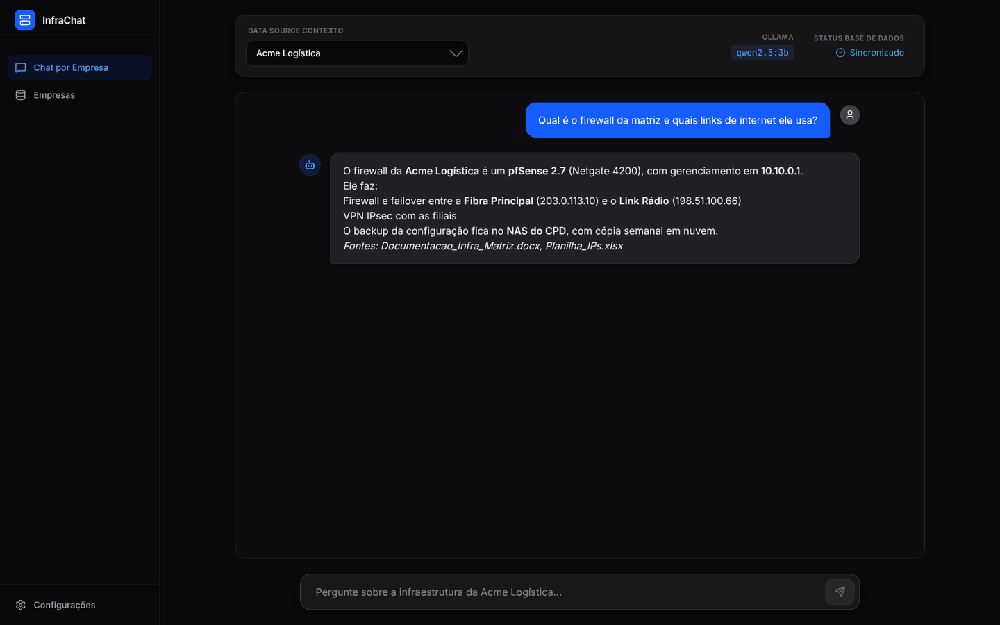
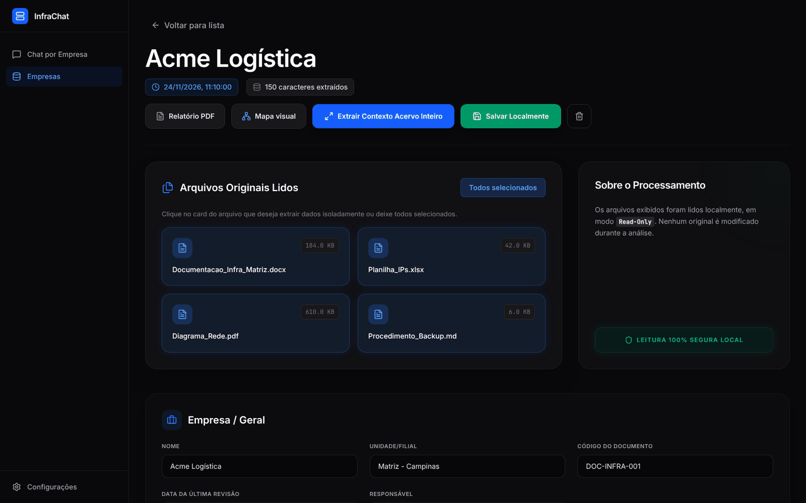

# InfraChat

Assistente desktop que responde perguntas sobre a **documentação de infraestrutura de cada empresa**: "qual o IP do firewall da filial X?", "onde fica o backup do servidor Y?". Por padrão roda com IA local, e os documentos não saem da sua máquina.



## Sobre

Quem atende várias empresas acumula pastas de documentação: diagramas, planilhas de IPs, manuais, procedimentos. Na hora do chamado, achar a informação certa leva mais tempo que resolver o problema. O InfraChat indexa a pasta de documentação, organiza por empresa e deixa você perguntar em linguagem natural, com a resposta vindo dos seus próprios arquivos.

## Funcionalidades

- **Organização por empresa**: cada subpasta da pasta raiz vira uma empresa
- **Leitura de documentos**: DOCX, PDF (com OCR para páginas digitalizadas), XLSX, TXT e Markdown. Os arquivos originais nunca são alterados
- **Chat por empresa**, com respostas baseadas nos documentos indexados
- **Mapa de topologia** da infraestrutura
- **Provedores de IA**: Ollama local (padrão) ou Groq, com a chave guardada criptografada no sistema
- Funciona com pastas sincronizadas do OneDrive ou do SharePoint

## Telas


<sub>Documentos lidos e dados extraídos de uma empresa</sub>

## Requisitos

- Node.js 20+
- [Ollama](https://ollama.com) rodando, com um modelo local. Em máquinas modestas, o `qwen2.5:3b` funciona bem
- Para OCR de PDFs digitalizados: [Tesseract OCR](https://github.com/UB-Mannheim/tesseract/wiki) instalado em `C:\Program Files\Tesseract-OCR` (os idiomas português e inglês já vêm na pasta `resources/`)

## Como rodar

```powershell
npm install
ollama pull qwen2.5:3b
npm run electron:dev
```

Para abrir a versão compilada: `npm run electron:start`.

Em **Configurações**, teste a conexão com o Ollama e escolha a pasta raiz com as subpastas das empresas.

Para validar: `npm run lint` e `npm run build`.

## Autor

Criado por **Guilherme Dill** · [RUNE Projects](https://www.runeprojects.com.br) · [GitHub](https://github.com/guilhermealceu)

## Licença

[MIT](LICENSE)
